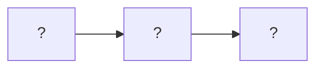

# The three-part framework, in my own words

Sources: CorrDiff and StormCast (abstract, introduction, conclusion).

## 1. Forecasting

- What it does:
- Input and output (variables, resolution, time step):

## 2. Downscaling (my focus)

- What it does:
- Input and output:

## 3. Bias correction

- What it does:
- Input and output:

## How they chain into a high-resolution forecast

## Where my prototype sits in this chain

-
